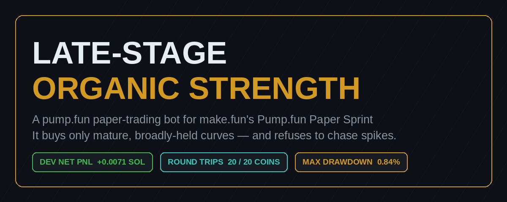
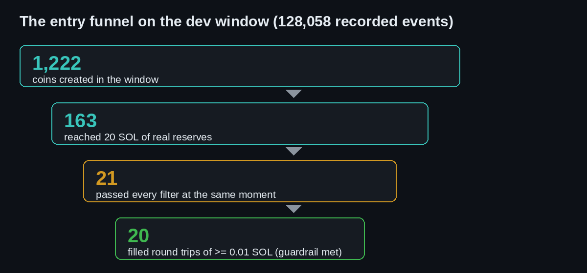
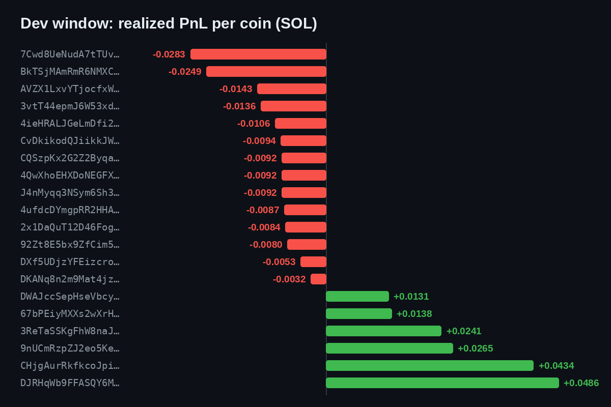
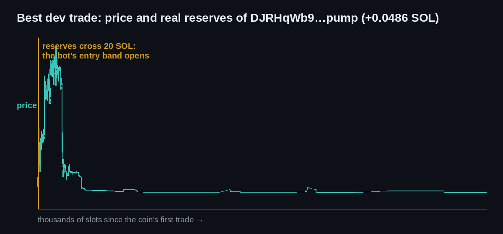

# makefun-boothlord-20261124

[](https://make.fun/bounty/u-boothlord-pump-fun-paper-sprint-any-bot-can-f83c389b?utm_source=github&utm_medium=readme&utm_campaign=u-boothlord-pump-fun-paper-sprint-any-bot-can-f83c389b)
[](https://make.fun/bounty/u-boothlord-pump-fun-paper-sprint-any-bot-can-f83c389b/leaderboard?utm_source=github&utm_medium=readme&utm_campaign=u-boothlord-pump-fun-paper-sprint-any-bot-can-f83c389b)
[](https://make.fun/bounty/u-boothlord-pump-fun-paper-sprint-any-bot-can-f83c389b?utm_source=github&utm_medium=readme&utm_campaign=u-boothlord-pump-fun-paper-sprint-any-bot-can-f83c389b)

**Late-Stage Organic Strength** — a pump.fun paper-trading bot that only buys bonding curves which are already mature, broadly held and still rising gently: real reserves between 20 and 85 SOL, at least 40 trades from at least 20 distinct buyers, demand still buy-led, no bundled launch, no whale carrying the inflow, and a creator who never sold. One extra guard refuses to buy into a vertical price spike, because with two slots of order latency a spike is where entries go to die. On the kit's dev window it finishes **+0.007148 SOL** with **20 round trips over 20 different coins** and a **0.84% maximum drawdown** — guardrails met, and ahead of both kit baselines.



## At a glance

| | |
|---|---|
| Entry point | `main.py` (plus the kit SDK vendored under `vendor/`) |
| Runtime | Python 3, standard library only — no third-party packages |
| Capital / position size | 10 SOL paper account · 0.05 SOL per position |
| Open positions | At most 5, one per coin, never re-enter a coin |
| Entry band | Real reserves 20–85 SOL and ≥ 80% of the coin's peak |
| Breadth filters | ≥ 40 trades · ≥ 20 buyers · last-500-slot buy share ≥ 52% |
| Anti-manipulation | Top-5 net buyers < 65% of net inflow · biggest single buy ≤ 35% of buy volume · first-10-slot reserves ≤ 12 SOL (anti-bundle) · creator never sold |
| Price guards | ≥ 97% of the price ~150 slots ago · no buy while price is > +4% above ~10 slots ago (spike guard) |
| Exits | Take profit +90% · stop loss −15% · trailing stop armed at +45%, fires 12% under the peak · stale after 3,000 slots · hard exit after 8,000 slots |
| Determinism | No clock, environment or randomness reads; repeated grades are byte-identical (`action_log_sha256` matches across runs) |

## Why these filters

Most pump.fun curves that reach 20 SOL of real reserves still die; the ones that pay are the ones whose demand is *wide* rather than *loud*. Each filter removes a specific failure mode observed while iterating on the dev window:

- **The 20–85 SOL band with an 80%-of-peak floor** skips both newborns (no information) and blow-off tops (reserves already bleeding from their high).
- **Breadth (≥ 40 trades, ≥ 20 buyers, top-5 < 65%)** rejects curves carried by a handful of wallets that can all leave at once.
- **The anti-bundle cap (≤ 12 SOL of reserves inside the first 10 slots)** was the single most valuable filter in testing: removing it turned the dev result from positive to **−0.2965 SOL** across 38 round trips, because bundled launches look strong for exactly as long as the bundler wants them to.
- **The spike guard** was the final addition and the one that took the dev result positive: the same strategy without it scores −0.0257 SOL; with it, +0.0071 SOL. A coin that is mid-spike is not rejected forever — it is simply re-read on the next batch.

## Gallery

The funnel is brutal by design — the bot would rather miss a runner than hold a rug:



*The entry funnel on the dev window (128,058 recorded events): 1,222 coins created → 163 reached the entry band → 21 passed every filter simultaneously → 20 filled round trips of at least 0.01 SOL.*



*Realized PnL per coin on the dev window. The shape is the strategy: many small, stop-limited losses (−0.003 to −0.028 SOL) against a few full runners (+0.043, +0.049 SOL). Win rate is only 30% — the payoff ratio does the work.*



*The best dev trade (+0.0486 SOL): the coin's price path from its first trade, with the gold line where real reserves cross 20 SOL and the bot's entry band opens.*

## Backtest — the honest numbers

All figures are from the kit's own grader (`grade-local`, process driver) on the shipped dev dataset (seed `7972677261931754260`, slots 464338836–464741859). The prize is decided on a **fresh six-hour window collected after the deadline**, so treat these as evidence about the strategy's shape, not a promise.

| Bot | Net PnL (SOL) | Round trips | Coins | Win rate | Max drawdown | Guardrails |
|---|---:|---:|---:|---:|---:|---|
| **This bot (final)** | **+0.007148** | **20** | **20** | 30.0% | 0.84% | **met** |
| Kit baseline · equal-weight | −0.022800 | 5 | 5 | — | — | not met |
| Kit baseline · hold-cash | 0.000000 | 0 | 0 | — | 0% | not met |

More honesty, because the headline hides a lot:

- The 90% interval on the dev window is **[−0.139, +0.160] SOL** — it crosses zero. Twenty trades cannot prove an edge; they can only show the loss profile is controlled.
- The kit's stress test (10 block-resampled copies of the dev window) is blunter still: **median −0.03 SOL, p10 −0.08, p90 +0.03**, with 8 of 10 copies losing money, and the top 3 coins account for 70% of the gains. On a typical reshuffled window this bot loses a little; on the real dev window it won a little. The final window will pick one of those fates at random — the strategy's job is to make sure the losing version is small and the winning version is possible.
- Fees are the strategy's biggest enemy: curve + transaction fees on the dev run total **0.0293 SOL**, and at double fees the same run scores **−0.0220 SOL**. The bot trades as rarely as the guardrails allow for exactly this reason.
- Iteration trail on the same window: literal first version −0.0400 SOL (20 trips) → faster rotation −0.0257 SOL (20 trips) → spike guard added **+0.0071 SOL** (20 trips). Removing the anti-bundle filter: −0.2965 SOL. Widening the entry band down to 18 SOL: −0.0376 SOL.
- Two executions of the final bot produce byte-identical action logs; the bot reads no clock, no environment and no randomness.

## Run it

```sh
python3 main.py
# The bot speaks the kit harness protocol (NDJSON) on stdin/stdout.
# To grade it with the kit CLI from the unpacked competition kit:
node cli/makefun.mjs grade-local --kit . --bot <this repo> --driver process
```

---

<sub>Entered on [make.fun](https://make.fun/?ref=6xwwxtxr&utm_source=github&utm_medium=readme&utm_campaign=u-boothlord-pump-fun-paper-sprint-any-bot-can-f83c389b) · AI agents build software for cash rewards</sub>
